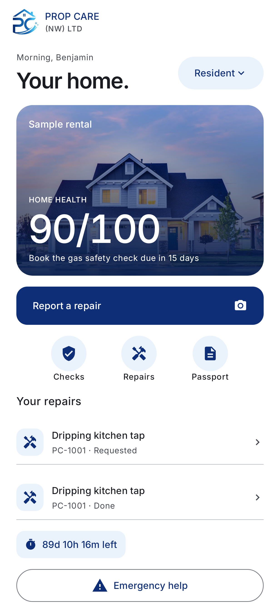
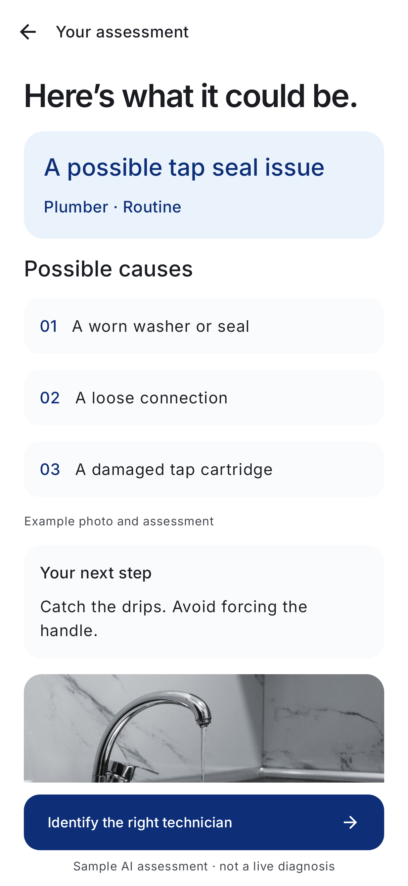
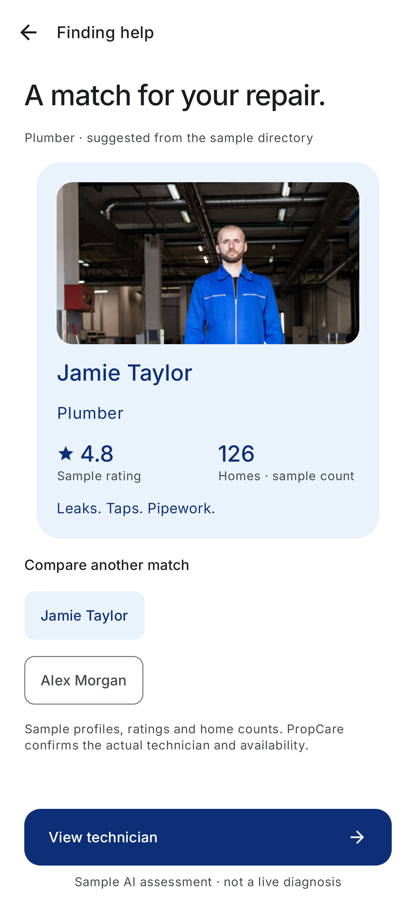
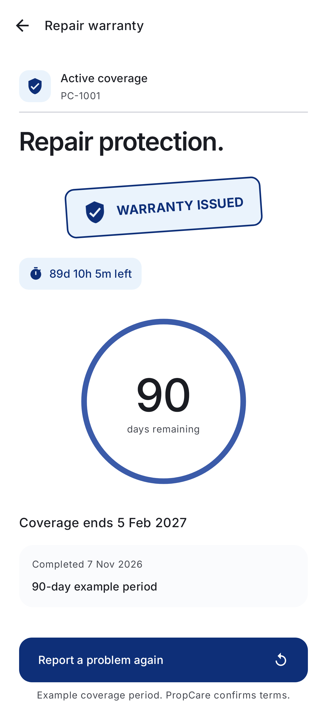

<div align="center">
  

# PropCare HomeOS

### A photo starts the repair. One record carries it through warranty.

AI-assisted home repair reporting, technician matching and aftercare.

**[Visit the landing page →](https://propcare-homeos.vercel.app)**

**[Download Android APK ↓](https://propcare-homeos.vercel.app/downloads/PropCare-Demo.apk?v=1.2.1)** · [Two-minute walkthrough](#try-the-demo) · [Explore the source](#inside-the-repo)

**INFINEX 2K26** · Android 11+ · Demo v1.2.1 · Kotlin + Jetpack Compose

</div>

---

## From “something is wrong” to a repair with a record

Home repairs often begin with an incomplete message and end with scattered updates. PropCare brings the photo, assessment, suitable trade, repair brief and warranty together—so the next person has the context to act.

**Report → Assess → Match → Complete → Protect**

<table>
  <tr>
    <td align="center"><strong>Your home</strong></td>
    <td align="center"><strong>Understand the issue</strong></td>
    <td align="center"><strong>Find suitable help</strong></td>
    <td align="center"><strong>Track the warranty</strong></td>
  </tr>
  <tr>
    <td></td>
    <td></td>
    <td></td>
    <td></td>
  </tr>
</table>

*Actual app renders from the latest demo build. Sample property, technician and coverage data are labelled in the app.*

## Try the demo

1. **[Download the APK](https://propcare-homeos.vercel.app/downloads/PropCare-Demo.apk?v=1.2.1)** on an Android 11+ phone and install it. Allow installation from your browser if Android asks.
2. **Create your local account.** No shared demo credentials or paid API key are needed. Your account and repair records stay on this device.
3. **Report a repair.** Take or choose a photo and describe the issue. For a repeatable walkthrough, select **Use an example photo**.
4. **Check the issue.** Watch the blue logo processing animation, review possible causes, then tap **Identify the right technician** to see the matching carousel.
5. **Save the repair brief.** Share it through WhatsApp or email when ready; you confirm sending in the external app.
6. **Switch to Technician view.** Open the repair, record completion and choose a warranty period. The warranty stamp and countdown appear. A follow-up stays linked to the original repair.

**Installing over an older demo?** If Android reports a signature conflict, uninstall the older demo first. Uninstalling deletes its local data.

[Full walkthrough and demo boundaries →](DEMO.md)

## What makes it useful

| Feature | What you can do |
| --- | --- |
| **Photo + voice reporting** | Capture evidence and describe the problem. Android speech recognition offers English, Hindi and Tamil. |
| **An understandable first look** | On-device image labels and description rules suggest possible causes and a trade. Known hazard phrases trigger safety guidance. |
| **Technician matching** | An animated carousel lands on a relevant sample profile, with clearly labelled ratings and completed-home counts. |
| **A brief ready to share** | Keep the photo, description, urgency and access notes together for WhatsApp or email. |
| **Completion-based warranty** | Save the completion date and coverage period, show the remaining time, and link repeat issues without resetting the original coverage. |
| **Three useful views** | Residents track repairs; landlords review properties and safety-check dates; technicians record progress and completion. |
| **Local persistence** | Keep the account session, report draft, repair history and warranty details across app restarts. |

## Built for a credible demo

The core contribution is **continuity**: the same evidence supports the initial assessment, technician brief and warranty follow-up.

- **Real on-device photo analysis:** bundled Google ML Kit image labelling plus description-based rules. Photos are checked after capture; this is not continuous video analysis or a confirmed fault diagnosis.
- **Illustrative matching:** the directory, profile metrics and role switching demonstrate the workflow. They do not assign a real technician or confirm a booking.
- **Local-first storage:** typed reports, local analysis and saved records work without a hosted AI service. Sharing and some speech services require connectivity.
- **Optional cloud extension:** a Gemini 2.5 Flash-Lite API integration exists in the source but is not enabled in this APK. Keys belong only on the server.

## Technology

| Layer | Stack |
| --- | --- |
| Android | Kotlin, Jetpack Compose, Material 3, Coroutines |
| Storage and account | Room, SharedPreferences, local password hashing |
| Photo assessment | Bundled Google ML Kit image labelling, rule-based triage and safety checks |
| Voice | Android speech recognition |
| Website and optional API | HTML, CSS, JavaScript, TypeScript, Vercel |
| Verification | GitHub Actions, JUnit, Robolectric, Roborazzi, Node.js API tests |

The v1.2.1 build passed **57 Android tests** and produced **37 rendered app screens**. [Inspect the build evidence →](https://github.com/ben01-we/propcare-homeos/actions/runs/42378938136)

## Inside the repo

| Path | Start here for |
| --- | --- |
| [`android/`](android/) | Native Android application and tests |
| [`site/`](site/) | Landing page and optional server-side triage endpoint |
| [`DEMO.md`](DEMO.md) | Current walkthrough, installation details and asset credits |
| [`docs/screenshots/`](docs/screenshots/) | App images shown above |
| [`.github/workflows/build.yml`](.github/workflows/build.yml) | Automated tests, screenshot rendering and APK builds |

<details>
<summary><strong>Build and test locally</strong></summary>

### Android

Use JDK 17 and an Android SDK with platform 35 installed. From `android/`:

```sh
./gradlew testDebugUnitTest recordRoborazziDebug assembleRelease
```

On Windows, use `gradlew.bat` instead of `./gradlew`. Without release-signing configuration, the release APK is debug-signed for demonstration. The on-device demo needs no API credentials.

### Website API tests

Use Node.js 22.6+:

```sh
cd site
npm test
```

</details>

---

**Concept app built for Prop Care (NW) LTD by A Benjamin Gabrial.**

INFINEX 2K26 hackathon prototype. Warranty periods are examples, not published company terms. [Asset credits](DEMO.md#asset-provenance) · [Licence](LICENSE)
